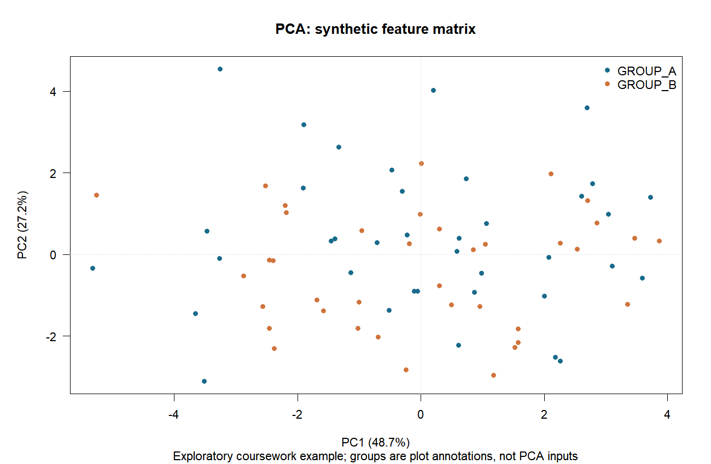
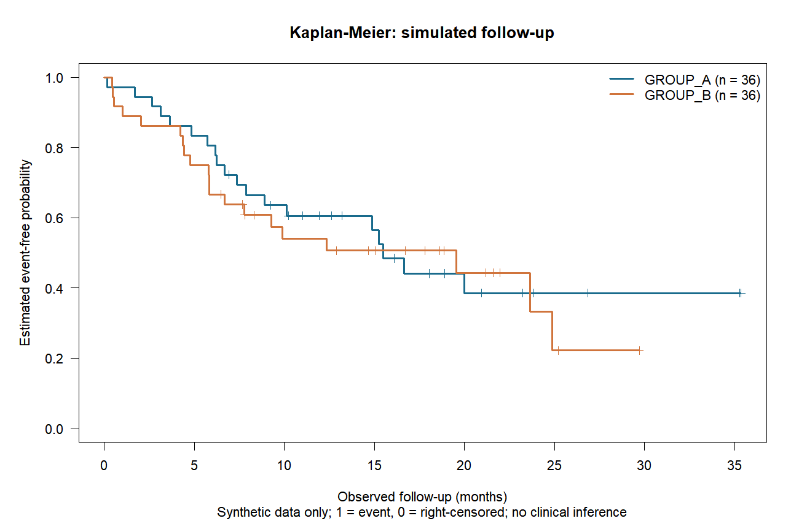

# Medical Data Analysis Coursework in R

A biomedical-engineering coursework portfolio covering data preparation, explicit table joins, PCA and right-censored survival analysis.

**Status: a later, AI-assisted reproducibility reconstruction using synthetic data.** This is a course-learning collection, not a clinical tool, a novel statistical method or a biomedical finding.

## Contribution and historical evidence

The early course framework came from teacher-provided templates; implementation details were developed with classmates. Later real-data exercises were primarily written by me, including group tasks where I was the main contributor/responsible member. Exact per-file contribution proportions were not reconstructed.

Twelve historical R files were located and syntax-checked. Two comprehensive scripts substantially overlap and represent one workflow. Their original real-data analyses and numerical results have **not** been rerun or validated.

The public code here is a **2026 AI-assisted reconstruction** of selected coursework themes. It does not republish the original teacher materials, clinical inputs, RData/RDS files or unreviewed helpers. See [attribution](ATTRIBUTION.md) and the [source/scope map](docs/SOURCE_MAP.md).

## Selected workflows

| Workflow | Implemented in this reconstruction | Boundary |
| --- | --- | --- |
| Cleaning | Normalize sample IDs and labels; remove exact duplicates; audit missing/invalid ages; reject conflicting repeated IDs | Invalid values are recorded, not silently invented or imputed |
| Integration | Explicit sample key, one-to-one validation, metadata-preserving left join and unmatched-ID reports | A join does not establish clinical meaning or cohort comparability |
| PCA | Align expression samples to metadata, transpose feature-by-sample input, remove documented incomplete/constant features, center and scale | Group labels annotate plots; they are not used to fit PCA; no diagnostic claim |
| Survival | Explicit 1=event / 0=right-censored coding, invalid-row audit, Kaplan–Meier curves, at-risk counts and a teaching log-rank calculation | No Cox prediction model, validated risk score, AUC or clinical inference |

Other historical volcano/heatmap/enrichment/nomogram/ROC material is outside this first release. In particular, old fixed volcano-plot annotation counts are not carried forward as computed results.

## Synthetic example and actual checks

Seed: **20261029**. Every sample ID starts with `SYN`; feature names are generic `FEATURE` labels. No real patient, clinical or gene-expression data were copied.

The included fixtures deliberately contain duplicate rows, invalid/missing values, unmatched IDs, one incomplete feature and one constant feature.

| Step | Observed result on the included synthetic fixtures |
| --- | --- |
| Metadata | 82 input rows → 80 unique IDs; 2 exact duplicates removed; 3 missing and 2 invalid ages audited |
| Follow-up join | 76 raw follow-up rows → 73 valid rows; 72 match metadata; 8 metadata IDs have no valid follow-up; 1 valid follow-up ID is unmatched |
| PCA | 12 features × 78 input samples → 10 features × 76 matched samples |
| Survival | 72 eligible matched records, 36 in each synthetic group |
| Checks | 14 targeted regression checks and 6 pipeline integrity checks passed |

These are data-flow and numerical consistency checks, not accuracy/performance or clinical validation. The original real-data course results remain unverified.





## Run

Use Rscript on PATH and an installed `survival` package. Tested reference: **R 4.4.1 + survival 3.6.4** on Windows. No package installation runs inside analysis scripts.

From the checkout root:

```sh
Rscript --vanilla scripts/check_environment.R
Rscript --vanilla tests/run_tests.R
Rscript --vanilla scripts/run_all.R --input-dir examples/input --output-dir work/recomputed
```

The script reads only the included fingerprint-verified synthetic fixtures. Outputs go to an ignored local work directory. Choose an empty output directory: existing results are not silently overwritten.

To regenerate the fixtures in a separate local directory:

```sh
Rscript --vanilla scripts/generate_synthetic_data.R --output-dir work/regenerated-input --seed 20261029
Rscript --vanilla scripts/run_all.R --input-dir work/regenerated-input --output-dir work/regenerated-results
```

Run from the checkout root and use relative paths. Do not invoke the original historical scripts on private clinical inputs as part of this demo.

See [dependency scope](DEPENDENCIES.md), [fixture definition](examples/README.md), [results guide](results/README.md) and [validation scope](docs/VALIDATION.md).

## Layout

- `R/`: side-effect-free cleaning, join, PCA and survival functions plus I/O utilities.
- `scripts/`: environment check, synthetic input generation and full demo entry point.
- `examples/input/`: newly generated text-only synthetic fixtures and fingerprints.
- `results/`: only regenerated, checked synthetic outputs for this demonstration.
- `tests/`: conflicting keys, event/censor semantics, hand-computable KM, PCA invariants and fingerprint checks.
- `docs/`: scope, provenance, validation and publication checklist.

## Limits and publication scope

No original clinical tables, teaching handouts, reports, RData/RDS, private identifiers, credentials, machine paths or unreviewed helpers are distributed. Do not add real data to this repository or publish outputs from a private cohort.

Input/output schemas and analyses are intentionally limited to the synthetic teaching example. Complete dependency locking, other R/package versions and other operating systems remain unverified. PCA signs may differ across numerical backends; inspect the documented invariants before interpreting differences.

No project-wide open-source license has been selected. Third-party R and survival retain their own licenses. Public availability of this coursework collection does not imply permission to redistribute excluded teacher/peer materials.
